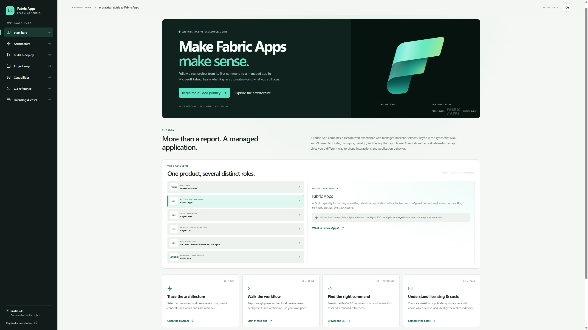

# AboutFabricApps

AboutFabricApps is an interactive learning studio for people who want to understand and build applications with Microsoft Fabric Apps and Rayfin. It is both a working Fabric App and an example project that you can run, study, and adapt.



## About the application

Fabric Apps let teams build web applications that run on Microsoft Fabric. **Rayfin** is Microsoft's project tooling and TypeScript SDK for creating and deploying these apps. A Fabric **workspace** is a shared place for organizing Fabric items; **capacity** is the compute pool that runs them; and an app's **backend** is the behind-the-scenes services it uses.

The goal is to reduce guesswork by making the platform pieces and workflow choices visible before you commit to tools or capacity. The guide is useful for Fabric users, developers, Power BI authors, and anyone comparing ways to create, publish, and maintain a Fabric App.

Explore the application to:

- See how Fabric, Fabric Apps, Rayfin, and authoring tools fit together.
- Select parts of an architecture diagram to learn what each one does.
- Compare six build and deployment approaches, including the Fabric workspace, Power BI Desktop for Apps (preview), VS Code with Rayfin, Git and environments, automation, and Fabricator.
- Browse a sample project structure, optional capabilities, and common Rayfin CLI commands.
- Learn how licensing, capacity, app permissions, and connected Power BI semantic models (reusable data and measures) differ.

The current app is a learning guide; it does not include a business-data connection. Its data and storage services are disabled, and Functions are not configured. The UI is protected by Fabric authentication when deployed. Fabric Apps availability and some features are currently subject to preview, tenant, and region requirements.

## What you need to get started

### To use a deployed copy

You need a Microsoft account that can sign in to the Fabric tenant where the app is deployed. The application requires authentication.

### To deploy your own copy

You also need:

- **Node.js 22.13 or later** and npm. npm is included with the Node.js installer.
- A Microsoft Fabric tenant where **Fabric Apps** are enabled. A tenant administrator may need to enable the preview feature.
- Permission to deploy to a Fabric workspace, and a workspace with usable Fabric capacity for the Rayfin deployment. Current options include Fabric capacity, an active Fabric trial, or existing Power BI Premium capacity with Fabric enabled. A Power BI Pro or PPU license alone is not Fabric capacity.
- A browser for signing in to Microsoft Fabric.

Git is needed if you want to clone the repository; alternatively, download its ZIP from GitHub. Visual Studio Code is a convenient editor, but it is not required. You do not need a GitHub Copilot subscription to use or modify this learning app.

Capacity and related Fabric services can incur charges. The amount depends on your capacity, region, duration, and actual use. Review [Fabric Apps licensing](https://learn.microsoft.com/en-us/fabric/apps/licensing) and [Fabric Apps pricing](https://learn.microsoft.com/en-us/fabric/apps/pricing) with your Fabric administrator before deploying.
Rayfin does not add a separate Rayfin-specific charge; the Fabric services behind the app use your workspace capacity. See [Rayfin capacity and billing](https://rayfin.ai/docs/deploy/pricing).

## Get the repository

The public GitHub URL has not been set up yet. After the repository is published, replace `OWNER` below with the GitHub username or organization that owns it. For example, the address will look like `https://github.com/OWNER/AboutFabricApps`.

### Option A — Download a ZIP

This is the simplest choice if you just want the files and do not need Git to track changes.

1. Open the AboutFabricApps repository page on GitHub.
2. Select **Code**, then **Download ZIP**.
3. When the download finishes, extract the ZIP file on your computer.
4. Open the extracted `AboutFabricApps` folder. Continue with [Option 1](#option-1-use-and-deploy-the-application-as-it-is) to deploy the app, or [Option 2](#option-2-modify-the-application-before-deploying) to make changes first.

### Option B — Clone with Git

Cloning downloads the repository and keeps it connected to GitHub. Git can record your changes and later download updates. Choose this option if you plan to customise the app or keep your local copy up to date.

Install [Git](https://git-scm.com/downloads), then open a terminal in the folder where you want the project saved. After the repository is published, replace `OWNER` with its actual GitHub owner and run:

```sh
git clone https://github.com/OWNER/AboutFabricApps.git
cd AboutFabricApps
```

The first command downloads the project into a new `AboutFabricApps` folder; the second moves your terminal into that folder. To open it in Visual Studio Code, run `code .` from there, or open that folder using **File → Open Folder**. If the `code` command is unavailable, use the menu.

### Option C — Clone with Visual Studio Code

Visual Studio Code can run the Git clone workflow for you. Install [Git](https://git-scm.com/downloads) and [Visual Studio Code](https://code.visualstudio.com/) first.

1. Open Visual Studio Code.
2. Open the **Source Control** view from the left sidebar, then select **Clone Repository**. Alternatively, open the Command Palette with **Ctrl+Shift+P** (Windows/Linux) or **Cmd+Shift+P** (macOS), and choose **Git: Clone**.
3. Paste the repository URL, replacing `OWNER` with the actual GitHub username or organization:

   ```text
   https://github.com/OWNER/AboutFabricApps.git
   ```

4. Choose where to save the local project.
5. When Visual Studio Code asks whether to open the cloned repository, choose **Open**.

You can now continue with [Option 1](#option-1-use-and-deploy-the-application-as-it-is) or [Option 2](#option-2-modify-the-application-before-deploying).

## Option 1: Use and deploy the application as it is

This path deploys the current source to a workspace that you control. Do not copy deployment or environment files from someone else; the repository is designed to start without them.

1. **Get the source** using any of the methods in [Get the repository](#get-the-repository), then open a terminal in the extracted or cloned `AboutFabricApps` folder.

2. **Install Node.js** if it is not already installed. Use [nodejs.org](https://nodejs.org/) and choose version 22.13 or later.

3. **Install the project tools and packages.** From the `AboutFabricApps` folder, run:
   ```sh
   npm install
   ```

4. **Sign in to Fabric from the Rayfin command line:**

   ```sh
   npx rayfin login
   ```

   Follow the sign-in prompts using the account that has access to your Fabric tenant.

5. **Deploy to your own workspace:**

   ```sh
   npm run rayfin:up
   ```

   On a first deployment, follow the prompts to choose your workspace. Rayfin builds the frontend and creates or updates the Fabric App and its configured services. This command changes resources in the selected workspace and can incur capacity usage; confirm the target before approving it.

6. **Open the deployed app.** Use the hosting link shown by the command. The app is protected, so sign in when prompted. To check deployment status later, run:

   ```sh
   npx rayfin up status
   ```

The starter configuration in [`rayfin/rayfin.yml`](./rayfin/rayfin.yml) includes only local development redirect addresses and no saved deployment target. Rayfin records and syncs the hosting origin when you deploy. It also creates local environment and deployment-state files when you develop or deploy; `.gitignore` excludes these files so you do not accidentally publish them.

### If deployment is unavailable

- If the **App (preview)** option is missing, ask your Fabric tenant administrator whether Fabric Apps is enabled for your tenant and region.
- If Rayfin cannot use the workspace, confirm your workspace permissions and that it has usable Fabric capacity. Pro and PPU licenses by themselves do not provide Fabric capacity for this Rayfin deployment.
- If sign-in uses the wrong account, run `npx rayfin login` again and check the active account with `npx rayfin login status`.
- For current setup and error guidance, see Rayfin's [deploy to Fabric guide](https://rayfin.ai/docs/start/deploy-to-fabric).

## Option 2: Modify the application before deploying

1. **Get and open the repository** using any method in [Get the repository](#get-the-repository). To open it in Visual Studio Code from a terminal:

   ```sh
   code .
   ```

   If the `code` command is not available, open Visual Studio Code and choose **File → Open Folder**.

2. **Install dependencies** from the project root:

   ```sh
   npm install
   ```

3. **Start the supported development workflow:**

   ```sh
   npx rayfin login
   npm run dev
   ```

   The frontend runs on your computer. By default, `rayfin dev` also connects it to a Rayfin backend in Fabric, creating or reusing the resources needed for development. It does **not** publish the production frontend. Backend operations can consume capacity. Follow the terminal's local URL and stop the process with `Ctrl+C`.

4. **Make your changes.** For common edits:

   - Change the learning text and reference links in [`packages/frontend/src/learning-content.ts`](./packages/frontend/src/learning-content.ts).
   - Adjust page layout and interactions in [`packages/frontend/src/LearningExperience.tsx`](./packages/frontend/src/LearningExperience.tsx).
   - Change colors, spacing, and responsive presentation in [`packages/frontend/src/LearningExperience.css`](./packages/frontend/src/LearningExperience.css).
   - Replace or add public images and icons in [`packages/frontend/public/`](./packages/frontend/public/).
   - The Fabric service setup is in [`rayfin/rayfin.yml`](./rayfin/rayfin.yml). Keep the authentication and hosting settings consistent with the access you want for your app.

   Text, links, and appearance changes usually stay within those content and UI files. New data connections, app-owned records, uploads, or server-side behavior are larger changes: they may require a Rayfin capability, new packages, service configuration, permissions, and separate cost/security decisions. Optional capability packs can add analytics, connectors, functions, storage, and other features. Apply one at a time from the project root, for example `npm run pack:add -- storage`; storage is not enabled in every Fabric environment. The available packs and their setup are described in [`.agents/skills/`](./.agents/skills/) and [`scripts/pack-manifest.md`](./scripts/pack-manifest.md).

   The Rayfin local-development plugin also provides a starter source activity. If you replace that starter surface, remove `sourceActivity: true` from `rayfinLocalDev` in `packages/frontend/vite.config.ts`, and update `App.spec.tsx`, `Root.spec.tsx`, and `Welcome.activity.ts`. Remove `Finley.tsx`, `Finley.css`, and `Finley.spec.tsx` together only if deleting that component. Keep the supported `@microsoft/rayfin-local-dev` integration; do not copy plugin internals into the app.

5. **Check your work** from the root folder:

   ```sh
   npm test
   npm run lint
   npm run typecheck
   npm run build
   ```

6. **Deploy your version** to your own workspace after reviewing its configuration and costs:

   ```sh
   npm run rayfin:up
   ```

   Do not deploy to a workspace unless you are authorized to change it. Afterward, use `npx rayfin up status` to check the deployment and open the hosting link Rayfin reports.

For Rayfin's local development workflow, see [Develop locally](https://rayfin.ai/docs/start/develop-locally). To learn the project CLI, see the [Rayfin CLI reference](https://rayfin.ai/docs/reference/cli).

## Application structure

```text
.
├── packages/
│   ├── frontend/       # React app, styles, tests, and public images
│   ├── data/           # Data package; currently not enabled as a Fabric service
│   └── shared/         # Shared TypeScript package
├── rayfin/
│   └── rayfin.yml      # Fabric services and frontend hosting configuration
├── scripts/            # Capability setup and project validation tools
├── .agents/skills/     # Optional Rayfin development guidance and capability kits
├── package.json        # Workspace commands and package configuration
└── package-lock.json   # Locked npm dependency versions
```

The learning UI is in `packages/frontend/src/`. Its main page is `LearningExperience.tsx`; the educational content is kept separately in `learning-content.ts`. Frontend tests are alongside the source as `*.spec.ts` and `*.spec.tsx` files.

## Technologies used

- **Microsoft Fabric** hosts the deployed app and provides its workspace, identity, and capacity. [Fabric Apps overview](https://learn.microsoft.com/en-us/fabric/apps/overview)
- **Rayfin** provides the CLI and TypeScript tools for local development and deployment. [Rayfin documentation](https://rayfin.ai/docs)
- **React** builds the interactive interface; **TypeScript** adds type checking to the JavaScript code. [React](https://react.dev/learn) · [TypeScript](https://www.typescriptlang.org/docs/)
- **Vite** runs the frontend during development and builds its production files. [Vite guide](https://vite.dev/guide/)
- **npm workspaces** install and manage the root project and its packages together. [npm workspaces](https://docs.npmjs.com/cli/using-npm/workspaces)
- **Git and GitHub** are optional ways to download, track, and share source changes; they are not required by the deployed app itself.

## Deployment and customisation considerations

- Deploy a new copy into a workspace you own or are authorized to use. This repository does not include a deployment target.
- The app uses Fabric authentication and protected static hosting. Its current configuration does not enable the data, storage, or Functions services.
- `npm run dev` uses a Fabric-backed development workflow by default; local frontend development is not the same as a fully offline Fabric emulator.
- Rayfin generates environment and deployment state locally. Keep those generated files private and do not add them to Git.
- Fabric capacity consumption and any connected Fabric services are billed according to your organization's capacity and actual usage. There is no fixed price estimate in this repository; use the live [Azure Fabric pricing page](https://azure.microsoft.com/en-us/pricing/details/microsoft-fabric/) and your organization's policies.
- Microsoft currently labels Fabric Apps as preview. Check the latest Microsoft documentation for supported features, licensing, and tenant requirements before relying on a workflow.

## Community Use & Attribution

This application is shared for the Microsoft Fabric community to use, explore, learn from, and build upon. You are welcome to deploy it in your own Fabric environment, customise or extend it, experiment with it, and use it as inspiration for your own projects.

If you share this application—or work substantially derived from it—in a presentation, demonstration, talk, showcase, or other public setting, I kindly ask that you acknowledge the original project and its author. Please don't present this application, or a substantially unchanged version, as your own original creation. I also ask that you don't submit it, or a substantially unchanged version, to Microsoft Fabric, Power BI, or another competition as your own entry.

Please feel free to make meaningful changes and make the project your own; learning from and building on it is encouraged. My request is simply that the original work is credited and not misrepresented. Thank you for respecting the time and effort that goes into creating and sharing community resources.

The public GitHub URL has not yet been established. Once published, replace `OWNER` in this link with the GitHub account or organization that hosts the project: [original AboutFabricApps repository](https://github.com/ChantifiedLens/AboutFabricApps).

This is a personal request, not an additional license term. The repository's [MIT license](./LICENSE) governs use and redistribution; it requires preservation of the copyright and permission notice in copies or substantial portions of the software.

## Resources

- [Microsoft Fabric Apps overview](https://learn.microsoft.com/en-us/fabric/apps/overview)
- [Fabric Apps licensing](https://learn.microsoft.com/en-us/fabric/apps/licensing)
- [Fabric Apps pricing](https://learn.microsoft.com/en-us/fabric/apps/pricing)
- [Rayfin quickstart](https://rayfin.ai/docs/start/quickstart)
- [Rayfin local development](https://rayfin.ai/docs/start/develop-locally)
- [Rayfin deployment guide](https://rayfin.ai/docs/start/deploy-to-fabric)
- [Rayfin CLI reference](https://rayfin.ai/docs/reference/cli)
- [Microsoft Rayfin source repository](https://github.com/microsoft/rayfin)

## Contributing or customising

You are welcome to adapt the explanations, visuals, and workflows for your own team. The project includes a [MIT license](./LICENSE); read it before redistributing your changes. If you publish improvements, follow the contribution process established on the GitHub repository. No additional project-specific support or contribution process is defined here.
